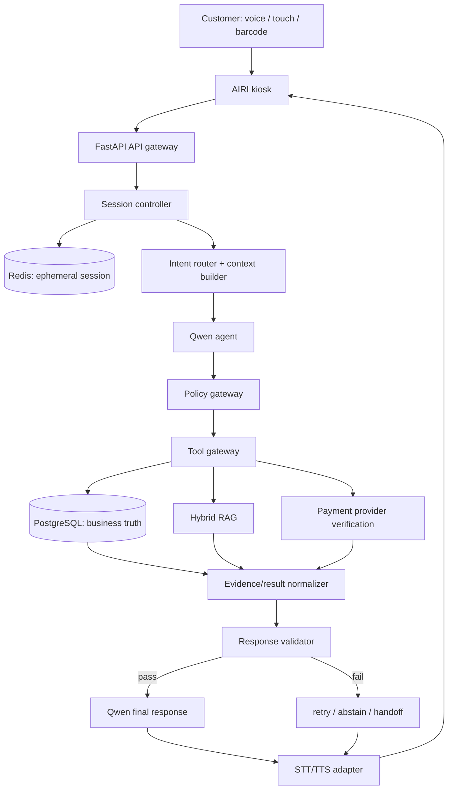

# AI Retail Assistant — Architecture Contract v1

**Trạng thái:** Frozen baseline  
**Ngày:** 2026-08-31  
**Nguồn yêu cầu:** `docs/requirements.md`

## 1. Quyết định kiến trúc

LLM là lớp hiểu ngôn ngữ, suy luận và chọn tool; LLM không phải nguồn sự thật nghiệp vụ. PostgreSQL giữ dữ liệu bán lẻ bền vững, Redis giữ shopping session tạm thời, hybrid RAG giữ kiến thức sản phẩm đã phê duyệt, còn payment provider/backend giữ sự thật giao dịch.

API tier phải stateless. Mỗi thao tác có ảnh hưởng nghiệp vụ đi qua Tool Gateway và Policy Gateway trước khi gọi service nội bộ. Response Validator kiểm tra evidence và các claim quan trọng trước khi câu trả lời được gửi đến kiosk.

## 2. Luồng end-to-end



## 3. Thành phần và trách nhiệm

| Thành phần | Trách nhiệm | Không được làm |
|---|---|---|
| AIRI kiosk | Avatar, microphone, touch fallback, product/cart/QR UI, trạng thái listening/thinking/speaking | Quyết định giá, tồn kho hoặc `PAID`. |
| API gateway | Authentication boundary, request ID, input validation, routing | Cho Qwen gọi REST tùy ý hoặc chạy SQL. |
| Session controller | Tạo/đóng session, TTL, kiosk ownership, đọc/ghi state theo session | Dùng global/in-process history hoặc trộn session. |
| Intent router/context builder | Chuẩn hóa intent và dựng context tối thiểu | Replay toàn bộ lịch sử hoặc expose toàn bộ tool registry. |
| Qwen agent | Hiểu yêu cầu, tạo structured arguments, chọn tool, diễn đạt kết quả | Tự phát minh catalog, tự cấp quyền, tự xác nhận thanh toán. |
| Policy gateway | Kiểm tra state, role, goal alignment, schema, limit, confirmation và rate limit | Tin rằng tool call từ LLM là an toàn mặc định. |
| Tool gateway | Map tool name cố định sang service call, normalize output | Cài tool runtime, nhận raw SQL/shell hoặc sửa source of truth ngoài quyền. |
| PostgreSQL | Product, inventory, batch, cart/order và audit data | Nhận ghi trực tiếp từ LLM. |
| Hybrid RAG | Truy xuất tài liệu kiến thức được duyệt, kèm provenance | Trả giá/tồn kho/hạn dùng realtime thay SQL. |
| Response validator | Kiểm tra số liệu, entity/evidence và intent constraints | Dùng self-confidence của LLM làm bằng chứng duy nhất. |
| Payment adapter | Tạo checkout sandbox, xác minh callback/status, idempotency | Chuyển `PAID` từ lời nói của customer hoặc output LLM. |

## 4. Data ownership

```text
Redis                 → session state, current cart context, short relevant turns
PostgreSQL            → products, prices, inventory, shelves, batches, orders, payments
Approved knowledge    → ingredients, nutrition, allergens, descriptions, store policy
Payment provider      → verified payment status and provider transaction identity
LLM                   → transient reasoning and natural-language response only
```

Session key có dạng `retail:session:<uuid>`, có TTL và không chứa persistent identity của anonymous customer. Order/cart rows phải gắn với session hoặc order owner theo contract; service phải kiểm tra ownership trước mọi write.

## 5. Session state machine

| State | Ý nghĩa | Chuyển hợp lệ |
|---|---|---|
| `NEW` | Session vừa được tạo, chưa có shopping request | `BROWSING`, `CLOSED`, `EXPIRED` |
| `BROWSING` | Hỏi sản phẩm, kiến thức hoặc gợi ý | `BROWSING`, `CART_ACTIVE`, `HANDOFF`, `CLOSED`, `EXPIRED` |
| `CART_ACTIVE` | Có giỏ hoặc đang thay đổi giỏ | `BROWSING`, `CHECKOUT_CONFIRMATION`, `HANDOFF`, `CLOSED`, `EXPIRED` |
| `CHECKOUT_CONFIRMATION` | Đã tính lại giỏ và chờ customer xác nhận | `PAYMENT_PENDING`, `CART_ACTIVE`, `HANDOFF`, `EXPIRED` |
| `PAYMENT_PENDING` | Đã tạo checkout, chờ provider verification | `PAYMENT_PENDING`, `CLOSED`, `HANDOFF`, `EXPIRED` |
| `HANDOFF` | Đang chờ/đã tạo yêu cầu cho nhân viên | `CLOSED`, `BROWSING` nếu staff trả lại session |
| `CLOSED` | Shopping episode đã kết thúc chủ động | Không mở lại; tạo session mới |
| `EXPIRED` | TTL hết hạn hoặc cleanup | Không mở lại; tạo session mới |

Không có chuyển trạng thái trực tiếp từ `BROWSING`/`CART_ACTIVE` sang `PAID`; trạng thái thanh toán là state của order/payment và phải đến từ backend/provider.

## 6. Context builder contract

Mỗi request gửi tới Qwen chỉ được tạo theo thứ tự:

1. Static system policy và identity của Customer Agent.
2. Current session state và kiosk ID đã được kiểm tra.
3. Minimal structured session state: preference tạm thời, product IDs đang xét, cart summary.
4. Chỉ các tool schema được phép trong state/intent hiện tại.
5. Các turn gần nhất có liên quan.
6. Current customer query.
7. Evidence/tool result khi request cần dữ kiện.

Không đưa secret, raw database query, full history của kiosk, dữ liệu session khác hoặc toàn bộ corpus vào context.

### Dynamic tool exposure

| Session/intent state | Tool được expose |
|---|---|
| `BROWSING` | `resolve_product`, `search_products`, `get_product_snapshot`, `get_product_knowledge`, `get_expiry_info` |
| `CART_ACTIVE` | `search_products`, `get_product_snapshot`, `get_cart`, `update_cart` |
| `CHECKOUT_CONFIRMATION` | `get_cart`, `create_checkout` (chỉ sau confirmation token hợp lệ) |
| `PAYMENT_PENDING` | `check_payment_status`, `handoff_to_staff` |
| Bất kỳ state nào | `report_product_issue` nếu có product/session context hợp lệ |

## 7. Policy gateway decision pipeline

```text
LLM tool request
  → parse ToolCallRequest
  → tool nằm trong static registry?
  → tool được expose ở state hiện tại?
  → role là customer và có permission?
  → arguments đúng schema và business limit?
  → tool phục vụ goal hiện tại?
  → cần confirmation đã có token hợp lệ?
  → rate/security checks
  → ALLOW / DENY / REQUIRE_CONFIRMATION / REQUIRE_CLARIFICATION / HANDOFF
```

Tool output cũng là dữ liệu không tin cậy đối với lớp sinh ngôn ngữ: phải normalize về schema, gắn source/evidence và đưa qua response validator.

## 8. API contract v1 (tên và mục đích)

| Method | Path | Mục đích |
|---|---|---|
| `POST` | `/sessions` | Tạo shopping session cô lập. |
| `POST` | `/sessions/{id}/close` | Đóng session và cleanup state. |
| `POST` | `/agent/respond` | Nhận user input, route agent và trả response/evidence. |
| `GET` | `/products/search` | Tìm candidate products bằng filter backend. |
| `GET` | `/products/{id}/snapshot` | Giá, tồn, kệ, promotion hiện hành. |
| `GET` | `/products/{id}/expiry` | Batch/hạn dùng theo FEFO. |
| `GET` | `/carts/{id}` | Cart authoritative summary. |
| `POST` | `/carts/{id}/items` | Add/remove/set quantity sau validation. |
| `PATCH` | `/carts/{id}/items/{product_id}` | Sửa quantity của một SKU. |
| `POST` | `/checkout` | Tạo checkout sau confirmation. |
| `GET` | `/orders/{id}` | Đọc order status. |
| `GET` | `/payments/{order_id}/status` | Đọc verified payment status. |
| `POST` | `/payments/callback` | Nhận callback provider, idempotent và signature-checked. |
| `POST` | `/issues` | Tạo incident product. |
| `POST` | `/handoff` | Tạo yêu cầu staff handoff. |
| `GET` | `/health` | Liveness của backend. |

Qwen chỉ gọi qua Tool Gateway; agent không được tự dựng URL hoặc gọi endpoint ngoài registry.

## 9. Failure behavior

| Failure | Hành vi bắt buộc |
|---|---|
| STT không hiểu | Yêu cầu nhắc lại và mở touch/text fallback. |
| Product resolution confidence thấp | Hiển thị candidate và yêu cầu chọn; không gọi tool phụ thuộc SKU mơ hồ. |
| RAG evidence yếu | Abstain với nhãn chưa xác minh hoặc handoff. |
| Qwen unavailable | Trả lỗi provider an toàn; không trả câu trả lời deterministic với nhãn model giả. |
| Payment provider unavailable | Báo không khả dụng, không đánh dấu `PAID`, cho phép handoff. |
| Redis unavailable | Fail closed để không trộn session; không fallback global memory. |
| Validation fail | Retry giới hạn, rồi abstain/handoff; log request ID và reason. |

## 10. Exit criteria của contract

- Enum và tool names khớp `docs/tool_contracts.md`.
- API paths khớp bảng contract và không expose raw REST cho LLM.
- Mỗi nguồn sự thật có owner duy nhất.
- State transition không cho phép thanh toán giả hoặc session reopen.
- ERD trong `docs/database_erd.md` biểu diễn các quan hệ cần cho P0/P1.
