# AI Retail Assistant — Database ERD Contract v1

**Trạng thái:** Frozen baseline  
**Ngày:** 2026-08-31  
**Nguồn:** `docs/requirements.md`, `docs/tool_contracts.md`

## 1. Phân tách state

- PostgreSQL lưu business truth, durable order/payment records, approved knowledge metadata và audit/evaluation records.
- Redis lưu session hash với key `retail:session:<uuid>`, TTL và short-lived cart/context state.
- Session không được lưu full anonymous conversation lâu dài.

## 2. ERD

```mermaid
erDiagram
    CATEGORIES ||--o{ PRODUCTS : groups
    PRODUCTS ||--o{ PRODUCT_ATTRIBUTES : has
    PRODUCTS ||--o{ PRODUCT_BATCHES : receives
    PRODUCTS ||--o{ INVENTORY : stocked
    SHELVES ||--o{ INVENTORY : locates
    PRODUCTS ||--o{ PROMOTIONS : qualifies
    PRODUCTS ||--o{ KNOWLEDGE_DOCUMENTS : describes
    KNOWLEDGE_DOCUMENTS ||--o{ KNOWLEDGE_CHUNKS : splits
    PRODUCTS ||--o{ CART_ITEMS : appears_in
    CARTS ||--o{ CART_ITEMS : contains
    CARTS ||--o{ ORDERS : converts_to
    ORDERS ||--o{ ORDER_ITEMS : contains
    PRODUCTS ||--o{ ORDER_ITEMS : sold_as
    ORDERS ||--o{ PAYMENTS : attempts
    PRODUCTS ||--o{ PRODUCT_ISSUES : concerns
    PRODUCT_ISSUES ||--o{ STAFF_HANDOFFS : escalates_to
    SESSIONS ||--o{ CARTS : owns
    SESSIONS ||--o{ PRODUCT_ISSUES : reports
    SESSIONS ||--o{ STAFF_HANDOFFS : requests
    SESSIONS ||--o{ AI_INTERACTIONS : records
    AI_INTERACTIONS ||--o{ TOOL_CALLS : emits
    SESSIONS ||--o{ SECURITY_EVENTS : scopes
    SESSIONS ||--o{ AUDIT_LOGS : scopes

    CATEGORIES {
        uuid category_id PK
        string name UK
    }
    PRODUCTS {
        string product_id PK
        uuid category_id FK
        string barcode UK
        string name
        boolean active
        datetime created_at
        datetime updated_at
    }
    PRODUCT_ATTRIBUTES {
        uuid attribute_id PK
        string product_id FK
        string key
        string value
    }
    PRODUCT_BATCHES {
        string batch_id PK
        string product_id FK
        integer quantity
        date manufactured_at
        date expiry_at
        datetime received_at
        string status
    }
    SHELVES {
        string shelf_id PK
        string label UK
    }
    INVENTORY {
        uuid inventory_id PK
        string product_id FK
        string shelf_id FK
        integer quantity
        integer reserved_quantity
        datetime updated_at
    }
    PROMOTIONS {
        uuid promotion_id PK
        string product_id FK
        string description
        integer price_vnd
        datetime starts_at
        datetime ends_at
        boolean active
    }
    SESSIONS {
        uuid session_id PK
        string kiosk_id
        string state
        datetime expires_at
        datetime closed_at
    }
    CARTS {
        uuid cart_id PK
        uuid session_id FK
        integer version
        string status
        datetime updated_at
    }
    CART_ITEMS {
        uuid cart_item_id PK
        uuid cart_id FK
        string product_id FK
        integer quantity
        integer unit_price_vnd
        integer line_total_vnd
    }
    ORDERS {
        uuid order_id PK
        uuid cart_id FK
        uuid session_id FK
        string status
        integer subtotal_vnd
        integer total_vnd
        string currency
        string idempotency_key UK
        datetime created_at
    }
    ORDER_ITEMS {
        uuid order_item_id PK
        uuid order_id FK
        string product_id FK
        integer quantity
        integer unit_price_vnd
        integer line_total_vnd
    }
    PAYMENTS {
        uuid payment_id PK
        uuid order_id FK
        string status
        integer amount_vnd
        string provider
        string provider_transaction_id UK
        string callback_event_id UK
        datetime verified_at
    }
    KNOWLEDGE_DOCUMENTS {
        uuid document_id PK
        string product_id FK
        string source
        string version
        boolean approved
        datetime ingested_at
    }
    KNOWLEDGE_CHUNKS {
        uuid chunk_id PK
        uuid document_id FK
        integer sequence_no
        string content_hash
        vector embedding
    }
    PRODUCT_ISSUES {
        uuid issue_id PK
        uuid session_id FK
        string product_id FK
        string issue_type
        string description
        string status
        datetime created_at
    }
    STAFF_HANDOFFS {
        uuid handoff_id PK
        uuid session_id FK
        uuid issue_id FK
        string reason
        string summary
        string status
        datetime created_at
    }
    AI_INTERACTIONS {
        uuid interaction_id PK
        uuid session_id FK
        string intent
        string outcome
        integer latency_ms
        datetime created_at
    }
    TOOL_CALLS {
        uuid tool_call_id PK
        uuid interaction_id FK
        string tool_name
        string policy_outcome
        string validation_outcome
        integer latency_ms
        datetime created_at
    }
    SECURITY_EVENTS {
        uuid event_id PK
        uuid session_id FK
        string event_type
        string severity
        string request_id
        datetime created_at
    }
    AUDIT_LOGS {
        uuid audit_id PK
        uuid session_id FK
        string actor_type
        string action
        string request_id
        datetime created_at
    }
```

## 3. Invariants bắt buộc

1. `products.product_id`, `product_batches.product_id`, `inventory.product_id`, `cart_items.product_id` và `order_items.product_id` cùng trỏ về catalog SKU chuẩn.
2. Một `CART` chỉ thuộc một `SESSION`; service phải reject mọi request không khớp session ownership.
3. Giá tiền lưu integer VND; `line_total_vnd`, `subtotal_vnd` và `total_vnd` do backend tính lại.
4. Checkout tạo order snapshot từ cart và dùng idempotency key; retry không tạo order trùng.
5. Payment callback có unique `callback_event_id`; provider transaction ID không được gắn cho hai payment khác nhau.
6. `PAID` chỉ là kết quả của payment verification; không có API customer nào nhận input `mark_paid`.
7. FEFO chọn batch `AVAILABLE` có `expiry_at` sớm nhất còn đủ quantity; không chọn batch đã hết hạn.
8. Knowledge chunk chỉ được retrieval khi document `approved = true`; product facts realtime không được ingest thay cho SQL.
9. Issue/handoff chỉ tạo incident, không sửa bảng source of truth.
10. Session durable audit record không chứa raw audio, secret hoặc full anonymous transcript ngoài retention policy đã chốt.

## 4. Chỉ mục và constraint tối thiểu

- Unique: `products.barcode`, `categories.name`, `orders.idempotency_key`, `payments.provider_transaction_id`, `payments.callback_event_id`.
- Index: `products.name`, `inventory.product_id`, `product_batches.product_id, expiry_at`, `knowledge_chunks.document_id`.
- Full-text index: product name/description fields phục vụ lexical retrieval.
- Vector index: `knowledge_chunks.embedding` sau khi pgvector được bật.
- Check constraints: mọi quantity không âm; money không âm; `expiry_at >= manufactured_at`; `reserved_quantity <= quantity`.
