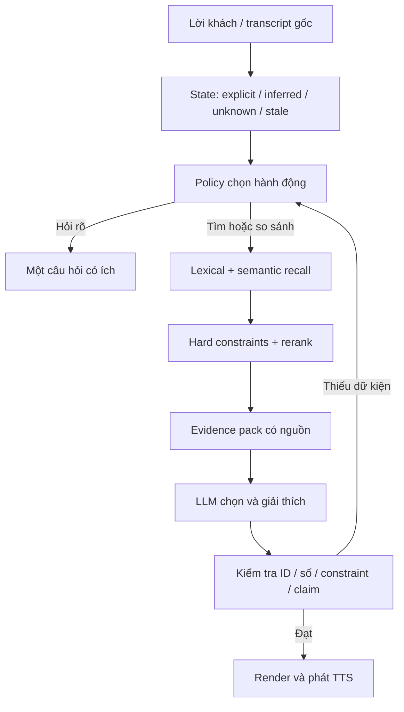

# Đối chiếu Sky với paper và hệ thống shopping assistant lớn

Ngày đối chiếu: **15/11/2026**. Đây là kết quả nghiên cứu và đề xuất kiến trúc, **chưa phải kết quả triển khai hay nghiệm thu kiến trúc mới**. Bằng chứng sửa lỗi/test trước đó ở [báo cáo follow-up](consultation_research_followup_20261115.md).

## 1. Kết luận

**Các hệ thống lớn có dùng LLM + catalog + tool như Sky. Điểm cần đổi là cách tổ chức quyết định và kiểm chứng, không phải bỏ DB hay giao toàn bộ cho LLM.** LLM nên hiểu mục đích, hỏi/chọn/so sánh và giải thích; dữ liệu cửa hàng xác lập sản phẩm, giá, thuộc tính và phép tính.

Sky đã có nhiều ranh giới đúng nhưng đang dựa quá nhiều vào prompt, lọc lexical và chuỗi sinh → tự review → sửa. Đọc thêm paper không có nghĩa cứ thêm một câu cấm hoặc một reviewer. Cần chuyển thành quản lý trạng thái hội thoại, policy chọn hành động, retrieval có đánh giá riêng và bằng chứng có thể kiểm tra.

Đây là nhận định từ code/trace của dự án; những kiến trúc dưới đây là nguồn đối chiếu, không chứng minh Sky đã đạt chất lượng tương đương.

## 2. Những hệ thống thực sự làm gì

| Nguồn chính | Điều nguồn công bố | Ý nghĩa với Sky |
| --- | --- | --- |
| [Amazon Rufus — công nghệ](https://www.amazon.science/blog/the-technology-behind-amazons-genai-powered-shopping-assistant-rufus) | Shopping LLM kết hợp RAG nhiều nguồn và Stores APIs; streaming có bước chèn dữ kiện từ hệ thống (hydration). | Giữ phần code cung cấp tên/giá. LLM tạo lời tư vấn và bố cục, không tự tạo sự thật của cửa hàng. Bài này công bố một phần kiến trúc, không phải toàn bộ hệ nội bộ. |
| [Rufus trên Bedrock, 20/11/2025](https://aws.amazon.com/blogs/machine-learning/how-rufus-scales-conversational-shopping-experiences-to-millions-of-amazon-customers-with-amazon-bedrock/) | Chọn nhiều model theo độ phức tạp; đưa sẵn context khi biết nhu cầu, tool khi cần; prompt caching và tool song song. Đánh giá cả chất lượng, latency và hội thoại. | Route theo nhiệm vụ/chất lượng, không chỉ đổi model khi hết quota. Tách đường tra giá nhanh với tư vấn mở cần suy luận. |
| [NVIDIA Retail Shopping Assistant](https://github.com/NVIDIA-AI-Blueprints/retail-shopping-assistant) | README hiện tại tách orchestration, catalog, durable memory, guardrails và UI. Có typed cart tools, tổng tiền tính bằng code, SSE và trace. | Giống hướng lõi của Sky. Đây là blueprint tham khảo, không phải bằng chứng đã đạt mọi ca retail production. README hiện dùng Deep Agents; mô tả “About” vẫn nhắc LangGraph/multi-agent nên không lấy phần About làm kiến trúc hiện tại. |
| [NVIDIA Catalog Architecture](https://github.com/NVIDIA-AI-Blueprints/retail-shopping-assistant/blob/3eca0719c130ecd840ece67b8f285b15a795312b/docs/CATALOG_ARCHITECTURE.md) | Schema khai báo field/taxonomy/filter capability từ dữ liệu; catalog dùng embedding + deterministic filter/rank, không có generative LLM hay learned reranker bên trong. | Không hardcode mọi ngành trong Python. Semantic retrieval và hard constraint có vai trò khác nhau. Cross-encoder là đề xuất cần thử của Sky, không phải mô tả NVIDIA đang dùng. |
| [COSMO, SIGMOD 2024](https://www.amazon.science/publications/cosmo-a-large-scale-e-commerce-common-sense-knowledge-generation-and-serving-system-at-amazon) | Học quan hệ commonsense theo nhu cầu người dùng; LLM tạo seed rồi critic học từ dữ liệu người gán nhãn, tiếp theo instruction tuning. | Quan hệ mục đích → loại hàng cần dữ liệu có kiểm định, không phải chỉ chứa đúng từ trong tên hàng. COSMO là hệ tri thức/search; chưa có căn cứ kết luận Rufus dùng nguyên hệ này. |

Đã kiểm tra repo NVIDIA ở revision `3eca0719c130ecd840ece67b8f285b15a795312b`, commit ngày 04/11/2026. [Assistant Architecture](https://github.com/NVIDIA-AI-Blueprints/retail-shopping-assistant/blob/3eca0719c130ecd840ece67b8f285b15a795312b/docs/ASSISTANT_ARCHITECTURE.md) còn cho thấy có grounding editor và deterministic renderer khi editor/draft không khả dụng. Vì vậy kết luận “hệ lớn không có review/fallback” là sai. Điều cần học là evidence boundary, giới hạn lượt sửa, memory và fallback có kiểm soát; không sao chép nguyên mọi cách diễn đạt của blueprint cho khách Việt.

## 3. Paper nào sát các lỗi hiện tại

### Quản lý cả phiên thay vì chấm mỗi câu

[RealWorldShop, Findings EMNLP 2026](https://aclanthology.org/2026.findings-emnlp.740/) đánh giá shopping trên 3,28 triệu sản phẩm với nhu cầu được tiết lộ/đổi dần. RealShop_Agent tách state manager, flow controller, catalog retriever và runtime guards; state có cả rejected options và stale dependencies. Hành động gồm hỏi, tìm, xác minh, so sánh, đề xuất và xác nhận.

Ablation của tác giả: cùng backbone gốc, thêm session control tăng success từ 0,55 lên 0,71; bản kết hợp adaptation đạt 0,82. Đây là bằng chứng trong benchmark của paper, không phải mức tăng dự đoán cho Sky. Simulator và LLM judge vẫn có giới hạn. Điểm đáng áp dụng là khi khách đổi ngân sách/đổi mục đích, phải vô hiệu hóa lựa chọn phụ thuộc, thay vì chỉ sửa tóm tắt hội thoại.

### Đúng yêu cầu vẫn có thể tư vấn chưa hay

[Shopping Reasoning Bench, 2026](https://arxiv.org/abs/2606.12608) có 525 missions và 10.863 rubric; chín model đạt 57–77% overall, chất lượng suy giảm khi flow dài. Paper tách recommendation, guidance, comparison, inquiry và conversational navigation. Bộ này không đại diện đầy đủ cho hàng tạp hóa/tiếng Việt; chỉ nên học cách xây rubric, không dùng điểm của nó để chấm Sky.

[CARTBench, preprint 04/11/2026](https://arxiv.org/abs/2611.05862) dùng yêu cầu thương mại ở 17 ngành với timeline và evidence cố định. Ba lỗi nổi bật là thêm thuộc tính không có chứng cứ, suy sự phù hợp quá xa, và coi điều chưa biết như đã rõ. 3/10 model vượt 90% Core, không model nào vượt 45% Excellence. Đây là kết quả dưới protocol của tác giả, chưa phải chứng minh một giải pháp production. Nó giải thích vì sao “không nói sai giá” vẫn chưa thành nhân viên tư vấn giỏi.

### Reviewer không tự biến thành nguồn sự thật

[Khảo sát self-correction, TACL 2024](https://aclanthology.org/2024.tacl-1.78/) ghi nhận kết quả yếu/không ổn định khi chỉ dùng feedback từ prompted LLM; feedback bên ngoài đáng tin hoặc huấn luyện có vai trò lớn. Điều này không có nghĩa reviewer luôn vô ích. Với Sky, reviewer vẫn hữu ích để phát hiện intent/usefulness, nhưng verdict của cùng model pool không chứng minh “dưỡng ẩm/ít kích ứng/đủ một bữa” là đúng.

[Self-RAG, ICLR 2024](https://arxiv.org/abs/2310.11511) học reflection tokens và retrieval theo nhu cầu; thêm prompt review chưa phải triển khai Self-RAG. [CRAG, 2024](https://arxiv.org/abs/2401.15884) đánh giá chất lượng retrieval trước khi chọn hành động sửa. Phần phù hợp cho Sky là phân biệt: thiếu ứng viên, thiếu dữ kiện, hay thiếu sở thích — mỗi lỗi cần cách xử lý khác nhau.

[Google preference elicitation, GENNEXT@SIGIR’25](https://research.google/pubs/asking-clarifying-questions-for-preference-elicitation-with-large-language-models-2/) nghiên cứu huấn luyện hỏi tuần tự từ hồ sơ bị che dần thông tin. [ICER cùng workshop](https://research.google/pubs/synthetic-dialogue-generation-for-interactive-conversational-elicitation-recommendation-icer/) giải quyết thiếu dữ liệu hội thoại elicitation. Đây là hướng học policy/dữ liệu, không đồng nghĩa nhắc model “hỏi một câu” là đủ.

## 4. Code hiện tại: giữ gì, đổi gì

Các vị trí dưới đây thuộc working tree đang sửa trên HEAD `38a9efb60e7919bcb2b95da5d5493076449591f7`.

| Thành phần hiện tại | Đánh giá và bằng chứng | Hướng thay đổi |
| --- | --- | --- |
| `Plan/RequirementUpdate`, `consult()` trong `backend/services/consultation.py` | Đã giữ yêu cầu có trích dẫn, ngân sách, exclusions; tốt hơn chỉ đưa history. Policy hỏi/chốt và phần inferred vẫn chủ yếu do prompt quyết định. | Tách explicit/inferred/unknown; source turn và state version; đánh dấu candidates stale khi constraint đổi. Inferred không trở thành hard filter. |
| `_retrieve_candidates()`, `_matching_candidates()`, `_diverse_candidates()` | Đã sửa category soft, subtype và lọc trước top-k. Snapshot search trong `backend/products/catalog.py` vẫn dựa vào token/metadata; MMR là lexical. | Benchmark hybrid retrieval và reranker, giữ nguyên hard filters. Đo candidate recall độc lập trước khi chấm câu trả lời. |
| `_compose_and_review()`, `_review_advice()` | Luồng tư vấn thông thường cần ít nhất plan + compose + review, chưa tính sửa/schema/provider fallback. Trace cho thấy cả false accept và review quá chặt gây 502. | Giới hạn call/time budget; kiểm tra cơ học trước; verifier có evidence; review ngữ nghĩa theo rủi ro và bằng chứng. Không bỏ gate trước khi có kiểm chứng thay thế. |
| `Choice.evidence_fields`, `_unsupported_claim()` | Gắn nguyên field không chứng minh toàn bộ lý do; regex chỉ bắt được các họ lời hứa đã biết. | Atomic claims + source span + loại claim. Code kiểm tra source/ID/số; verifier kiểm tra ý nghĩa. Exact span trùng nhau không có nghĩa claim được entail. |
| `_render_answer()`, `retail_tools.py` | ID, giá, gram và tổng tiền do code xác lập; đây là nền đúng cần giữ. | Mở rộng evidence contract, không đưa phép tính về LLM. |
| Voice trong `App.vue`, `voice-neural.ts`, `azure_stt.py` | HTTP WAV STT, có preview speculative; HTTP TTS chunk thật. Không phải streaming STT liên tục hay integration LiveKit. | Benchmark streaming STT trong nhánh riêng, giữ transcript gốc; đo hiệu quả trước khi thay runtime. |

Kiểm tra trực tiếp snapshot cũ: 3.099 dòng nguồn, 3.081 được nhận (18 quarantine); không có ingredients/allergens/nutrition/usage instructions, không description nào dài hơn tên sau chuẩn hóa khoảng trắng. SHA-256 vẫn là `a0eb16ac1ae2557ea8c272c680a1f17d360934da6138585e09314df5d04f19d6`. Hạn chế dữ liệu là thật; nó không giải thích cho việc hỏi giá mà trả lý thuyết hoặc quên điều khách đã nói.

Những lỗi còn lại đã có trace ở [báo cáo thực nghiệm](consultation_research_followup_20261115.md): gán dưỡng ẩm cho bông tẩy trang, suy “ít gây kích ứng”, đổi tiền thành khối lượng/khẩu phần, và lỗi quota. Không coi bản sửa retrieval là đã sửa được tất cả các lỗi sinh câu.

## 5. Kiến trúc đề xuất cho quy mô đồ án

Đây là thiết kế đề xuất, chưa phải runtime đã triển khai.

**Policy hội thoại:** điều phối theo task và decisive unknown, không thêm nhánh riêng theo từng SKU/câu mẫu. Với một yêu cầu quà tặng mở, thông tin về sở thích có thể thay đổi lựa chọn; với “giá thịt”, có thể trả các mức giá thật đang có rồi hỏi loại muốn xem. Các ví dụ là cách chấm policy, không phải đáp án hardcode.

**Retrieval:** so lexical baseline với lexical + dense recall, rồi thử cross-encoder trên 20–50 ứng viên. Với 3.081 SKU có thể lưu vector trong tiến trình/file cache; chưa cần thêm Milvus chỉ vì blueprint dùng nó. Exact SKU/brand/size vẫn đi đường lexical. Không tự bỏ constraint để tạo kết quả.

Ứng viên thử: [Qwen3-Embedding-0.6B](https://huggingface.co/Qwen/Qwen3-Embedding-0.6B), [Qwen3-Reranker-0.6B](https://huggingface.co/Qwen/Qwen3-Reranker-0.6B), [BGE-reranker-v2-m3](https://huggingface.co/BAAI/bge-reranker-v2-m3). Qwen công bố hỗ trợ 100+ ngôn ngữ; chưa có phép đo retail tiếng Việt của dự án. Không gọi model nào “mạnh nhất” hoặc nâng production theo leaderboard chung. Đo chất lượng cùng cold/warm latency và RAM trên máy thật.

**Evidence:** tách SKU facts với kiến thức dùng hàng chung. Một claim có `subject_id/predicate/value/source_field/source_span`; code kiểm tra source tồn tại, số và đơn vị; semantic verifier đánh giá suy luận. “Vị phô mai” không suy ra “nhiều đạm/no lâu”; đúng loại thịt không bắt buộc tên có từ “lẩu”. Khi thiếu nguồn, chỉ nêu giới hạn có liên quan và vẫn giúp chọn/đặt câu hỏi. Không đọc cấu trúc dữ liệu cho khách.

**Tốc độ và fallback:** cache phần prompt/tool schema tĩnh, gom request độc lập, route model theo nhiệm vụ, giới hạn retry toàn lượt. Fallback key/model bảo vệ khả dụng; model dự phòng cũng phải vượt cùng quality gates. Tránh đang sinh chưa được kiểm chứng đã đưa cả câu ra loa; có thể stream từng đơn vị đã kiểm tra. Không chỉ thêm câu đệm để che latency.

**Huấn luyện:** chỉ SFT/DPO/critic sau khi có đủ hội thoại và nhãn chất lượng đã người kiểm tra. Synthetic data hữu ích để tăng độ đa dạng nhưng cần kiểm định, không để một model tự sinh cả đề/đáp án/chấm rồi báo thắng.

## 6. Voice: học kiến trúc, không sao chép ngưỡng

[LiveKit turn-taking tuning](https://docs.livekit.io/agents/logic/turns/tuning/) tách audio processing, VAD, end-of-turn, interruption và preemptive generation. Đây là cách phân rã đáng học: một threshold không giải quyết đồng thời tiếng quạt, ngắt câu và barge-in.

Theo [danh sách turn detector chính thức](https://docs.livekit.io/agents/logic/turns/turn-detector/) đọc ngày 15/11/2026, audio detector và text multilingual detector liệt kê 14 ngôn ngữ, **không có tiếng Việt**. Điều đó không có nghĩa LiveKit transport không chạy được vi-VN; nghĩa là không có căn cứ coi detector đó đã được hỗ trợ/hiệu chỉnh cho tiếng Việt. Không tự chuyển framework để kỳ vọng hết lỗi dấu.

Bản hiện tại cần đo riêng:
- WER/CER, dấu và từ khóa ảnh hưởng ý định trên giọng Việt thật.
- Audio thô → browser capture → upload → provider → API, để định vị lỗi code.
- False activation khi chỉ có quạt/điều hòa; missed speech với tiếng nhỏ.
- Cắt mất đầu/cuối, ngắt nhầm lúc tự sửa câu và độ trễ dừng TTS khi khách nói.
- End-of-speech → STT final → LLM first validated text → TTS first audio; báo p50/p95.

Các fixture cũ 6/6 đúng và browser WebAudio không thay thế test mic/loa vật lý. Nghiên cứu này không tạo bằng chứng mới rằng voice đã hoàn hảo.

## 7. Thứ tự làm và phép thử để quyết định

1. **P0 — baseline khóa trước:** bộ 120–200 câu tiếng Việt và ít nhất 30 flow 6–12 lượt, đa ngành, đổi ý/phủ định/mơ hồ. 35 câu user là regression công khai; phần holdout tách theo scenario/product family, không chỉ đổi vài chữ. Mỗi ca có rubric theo nhu cầu, dữ kiện, điều còn chưa biết và hành động chấp nhận được.
2. **P1 — state/policy + evidence:** thêm trạng thái nguồn/stale; chọn action rõ; kiểm tra claim độc lập. Giữ retrieval/model hiện tại để đo riêng phần cải thiện.
3. **P2 — ablation retrieval:** lexical → hybrid → hybrid+rerank, trên cùng holdout và hard filters. Đo Recall@20, nDCG@5, tỷ lệ sai constraint và miss variant; sau đó mới chấm answer.
4. **P3 — giảm lượt gọi:** so full review với conditional review có verifier/code gate; đo false accept, false reject, task success, p95 và quota errors. Không hy sinh gate chỉ để số latency đẹp.
5. **P4 — voice song song về kỹ thuật nhưng nghiệm thu riêng:** so HTTP/preview với streaming STT; cùng audio và điều kiện mic/loa. Chỉ giữ phiên bản giảm trễ mà không tăng cắt câu, sai dấu hoặc false activation.
6. **P5 — data/post-training:** lưu mẫu thất bại và sửa của người chấm, hỏi nào giúp quyết định, lựa chọn nào bị từ chối; sau đó mới đánh giá SFT/DPO.

Cần chấm cả **đúng** và **hữu ích**: không bịa chưa đủ nếu chỉ hỏi lại hoặc lặp tên/giá. Human rubric tách đúng nhu cầu, giữ constraint, grounding, tiến triển quyết định, tự nhiên/ngắn gọn. Ít nhất hai người chấm một tập con, kiểm tra độ đồng thuận và phân xử; judge ngoài runtime chỉ hỗ trợ. Lưu cả failure/provider error; không tính chúng thành câu đạt.

Các cỡ bộ test và bước thử là **đề xuất của dự án**, không phải số tối ưu được các paper chứng minh. Chốt ngưỡng nghiệm thu trước khi thử phương án, báo khoảng tin cậy/số mẫu thay vì khẳng định 100% trong vận hành.

## 8. Việc đã thực hiện trong đợt nghiên cứu này

- Đọc nguồn chính thức, cả full text các phần phương pháp/giới hạn của benchmark 2026 và docs/code NVIDIA ở revision cố định.
- Đối chiếu với retrieval, planner, composer, reviewer, renderer và voice đang có.
- Kiểm tra lại độ phủ dữ liệu catalog và giữ nguyên hash.
- Viết thiết kế, ablation và kế hoạch trên. **Chưa triển khai hybrid/reranker, policy mới, fine-tuning hay LiveKit; chưa đo chất lượng các phương án đó.**

Manifest mã/dữ liệu/artifact đối chiếu: [consultation_research_followup_manifest_20261115.json](artifacts/consultation_research_followup_manifest_20261115.json). Số test trong manifest được đọc từ kết quả kiểm tra đã lưu ở lần sửa trước, không phải lượt chạy mới cho báo cáo này.
