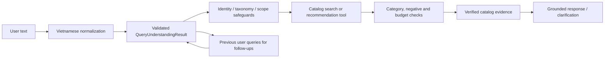

# Nâng cấp tư vấn catalog tổng quát — 28/10/2026

## 1. Tóm tắt

Đợt này sửa pipeline tư vấn sản phẩm để tách ý định và nhóm hàng khỏi phần mô tả nhu cầu, hiểu một số cách gọi nhóm hàng đời thường, giữ phạm vi nhóm qua câu hỏi tiếp theo, xếp giá trong đúng phạm vi đã chọn, và không biến dữ liệu thiếu thành lời khẳng định về công dụng. Bộ xử lý mới đối chiếu taxonomy đang dùng và metadata sản phẩm; không thêm nhánh production theo SKU hay câu benchmark.

Lượt rà soát ngày 28/10 bổ sung sửa lỗi tổng quát cho ưu tiên nhãn lá taxonomy so với alias ngắn, vẫn giữ alias khi cụm trực tiếp chỉ là nhãn cha hoặc alias thể hiện đối tượng người dùng nói rõ; nhận diện chính xác nhãn một từ có dấu như “Gối”/“Sổ”; và giữ mục đích nấu lẩu khi khách tiếp tục thu hẹp từ “thịt” sang “thịt bò”. Parser cũng không còn hiểu nhầm “sữa tắm nam” thành ngân sách “tầm năm”.

Kết quả chính trên bộ kiểm tra tự sinh từ snapshot:

- 150 truy vấn sản phẩm ở dev: Recall@1/@5 là **1,0000/1,0000**. Held-out có 360 truy vấn sản phẩm: Recall@1 **0,9972**, Recall@5 **1,0000**. Một biến thể typo đứng SKU trùng tên ở hạng 1; SKU gold đứng hạng 2.
- Độ chính xác nhóm hàng trong top 5 tăng từ **0,00** lên **1,00** ở 40 truy vấn nhóm hàng dev và 120 truy vấn nhóm hàng held-out. Bổ sung fallback taxonomy tổng quát khi cụm duyệt nhóm bị dùng nhầm làm từ khóa tên hàng; kiểm soát brand ngắn trùng từ tiếng Việt.
- 20/20 hội thoại dev và 50/50 hội thoại held-out giữ được nhóm hàng qua 3 lượt, sắp thứ tự giá tăng dần ở lượt hỏi “rẻ nhất”, và giữ nhóm khi hỏi phương án khác.
- Full suite cuối sau lượt sửa taxonomy/ngữ cảnh/audience: **1.107 passed in 177,20s**; Ruff: **All checks passed**. Regression taxonomy chạy trên toàn bộ nhãn lá vẫn qua; các lượt “ăn lẩu” và “mình thích thịt bò” giữ mục đích/nhóm liên quan.
- Benchmark local chạy lại ngày 28/10: Recall sản phẩm @1/@5 **1,0000/1,0000** dev và **0,9972/1,0000** held-out; category precision@5 **1,0000** trên cả hai tập. Query compiler p50/p95 **57,59/96,53 ms** dev, **54,19/90,86 ms** held-out. Smoke SSE được chạy ở lượt trước; không chạy lại ở vòng sửa taxonomy này.
- Bộ parser pilot 50 câu do nhóm dự án tự viết đạt exact match **50/50** sau sửa audience alias. Đây là bộ phát triển đã dùng để dò/sửa lỗi, không phải held-out hoặc đánh giá bởi annotator độc lập; không đo chất lượng câu trả lời/tool end-to-end.

**Không được diễn giải các điểm này thành “đã giải quyết tư vấn ngữ nghĩa”.** Các truy vấn sản phẩm là mẫu được sinh từ tên catalog: một câu có lời dẫn, một câu bỏ dấu, một câu xóa một ký tự. Chúng đo tìm tên/nhóm và độ bền với biến thể bề mặt, không đo đủ cách khách mô tả công dụng bằng lời riêng, mức hợp sản phẩm, hay độ tự nhiên. Các nhãn SKU và taxonomy lấy độc lập từ dữ liệu nguồn, không lấy từ output hệ thống; nhưng chưa có bộ câu do người dùng viết và gán nhãn độc lập.

## 2. Repository, dữ liệu và phạm vi

- Branch làm việc: `codex/retail-text-quality-v4-20261019`.
- Catalog nguồn: `data/winmart_products.json`, SHA-256 `a0eb16ac1ae2557ea8c272c680a1f17d360934da6138585e09314df5d04f19d6`.
- File nguồn có 3.099 dòng sản phẩm; repository xác thực 3.081 sản phẩm và cách ly 18 dòng lỗi. Có 346 đường taxonomy và 344 nhãn lá khác nhau.
- Mốc dữ liệu là snapshot WinMart ngày 15/09/2026. Giá và số tồn trong snapshot không xác nhận giá/tồn trực tiếp tại cửa hàng hiện nay.
- Các trường có sẵn gồm tên, thương hiệu, danh mục, giá, giá sale, khuyến mãi, số tồn snapshot, vị trí kệ, đơn vị, mô tả và ngày lấy dữ liệu. Trong 3.099 dòng, 2.868 mô tả trùng tên sản phẩm và 3.092 mô tả ngắn hơn 80 ký tự. Catalog không có số lượt bán hay đánh giá khách hàng; cũng thiếu thuộc tính công dụng, thành phần, thông số và mức phù hợp chi tiết cho nhiều mặt hàng.
- Không thay schema public của API, frontend, sessions, giỏ hàng demo, thanh toán demo, planogram hay tích hợp STT/TTS trong đợt text này. Smoke dùng test client của FastAPI và endpoint `/agent/respond/stream`; đây không phải kiểm thử trình duyệt, micro, STT hoặc TTS.

## 3. Audit và nguyên nhân gốc

| Lớp lỗi | Dấu hiệu trong code/ca tái hiện | Nguyên nhân | Thay đổi |
| --- | --- | --- | --- |
| Hiểu intent | Câu tìm nhóm hoặc hỏi giá/bán chạy nhất có thể bị coi như một mảnh tên hàng; các cụm nói về nhu cầu dính vào tên sản phẩm. | Pipeline cũ trộn raw query với chuỗi tìm catalog, một số ý định được suy ra từ token rời. | Tạo `QueryUnderstandingResult`; tách `product_type`, `product_reference`, `use_case`, điều kiện âm, ngân sách, thứ tự xếp hạng và tham chiếu hội thoại. |
| Chọn nhóm / truy hồi | Phrase thuộc taxonomy, ví dụ nhãn có cụm “nấu nướng”, từng bị hiểu như yêu cầu chế biến; cụm “Các loại bột khác” bị dùng làm từ khóa tên hàng nên trả rỗng. | Không tách phrase taxonomy khỏi phần nhu cầu; truy vấn nguyên câu bị dùng như cụm tên. | Đối chiếu các đoạn nhãn taxonomy đang hoạt động, duyệt toàn nhóm khi câu chỉ nêu nhóm và còn từ khóa không có bằng chứng; giữ modifier có bằng chứng và phạm vi catalog. |
| Nhận diện brand | Cụm category không dấu như “khan mat cac” có thể bị khớp với brand ngắn `CAC`, làm lọc nhầm và trả rỗng. | Chuẩn hóa bỏ dấu làm mất khác biệt giữa “các” và brand viết ASCII; bước dò brand chạy trước khi loại truy vấn duyệt taxonomy. | Chỉ kiểm tra category browse khi thực sự có brand ngắn mơ hồ; không dùng brand đó để ép lọc nếu câu là duyệt taxonomy. |
| Ranking | “Rẻ nhất” cần áp dụng trong đúng nhóm/những lựa chọn vừa nêu; “bán chạy nhất” không thể suy ra từ tồn kho hay vị trí trên danh sách. | Phạm vi hội thoại và tiêu chí xếp hạng chưa được biểu diễn tách biệt; snapshot thiếu doanh số/rating. | Giữ truy vấn trước cho tool tìm kiếm/tư vấn; sắp giá từ trường `price_vnd`; khi thiếu doanh số/rating thì nói rõ và không gán thứ hạng. |
| Tư vấn / bằng chứng | Mục đích như “da đầu nhanh bết” không có thuộc tính đối chiếu, dễ dẫn đến câu từ chối gượng hoặc khẳng định vượt dữ liệu. | Catalog chủ yếu có title; không có schema thuộc tính đủ để chứng minh sự phù hợp. | Tool trả rõ `use_case_verified`; chỉ nêu title/giá đã có; diễn đạt là chưa đủ dữ liệu để xác nhận phù hợp và đưa lựa chọn lọc tiếp theo. |
| Ngữ cảnh | “Loại nào rẻ nhất?”/“có loại khác không?” có thể rời khỏi nhóm vừa chọn hoặc dùng nhầm use case của nhóm trước. | Không truyền các câu người dùng trước tới tất cả đường tìm/recommend liên quan. | Chỉ truyền lịch sử câu hỏi cần thiết tới `search_products` và `recommend_products`; parser dùng nó để giải tham chiếu, không áp bừa context cũ cho mọi tool. |
| Alias và taxonomy | “Cá nước ngọt tươi” từng rẽ sang “Nước ngọt có ga”; tên một từ có dấu có thể bị lọc như từ nối; “kem chống nắng cho bé” rơi mất đối tượng trẻ em; “thịt bò” làm mất mục đích lẩu. | Resolver ưu tiên alias ngắn hơn nhãn lá; bỏ dấu làm “Gối/Sổ” trùng từ gói/số; alias audience không thắng category chung dù câu nêu đối tượng; bộ nhớ scope so category theo chuỗi bằng nhau nên không nhận parent → child. | Ưu tiên leaf exact khi cụm được nêu nguyên vẹn; dùng alias khi direct match là parent/phrase ngắn hoặc alias thêm audience tường minh; giữ exact native label; nối context qua quan hệ taxonomy và bỏ false budget “tầm năm” trong “sữa tắm nam”. |

Benchmark cũ có thể trông đạt khi chỉ có đúng một tên hàng/category con làm bằng chứng. Bộ mới bổ sung nhiều SKU và taxonomy lá để kiểm tra lỗi tìm tên và scope, nhưng cũng chưa đo được chất lượng tư vấn ngữ nghĩa đầy đủ. Một lỗi được bắt trong vòng cuối là category label “Đồ dùng nấu nướng” bị tách thành loại “đồ dùng” và nhu cầu “nấu nướng”; parser nay bỏ phần use-case nếu cụm đó nằm trong cùng đoạn nhãn category đầy đủ.

## 4. Nghiên cứu và quyết định kỹ thuật

| Nghiên cứu | Bài toán / điều rút ra | Cách áp dụng và quyết định |
| --- | --- | --- |
| [Which Works Best for Vietnamese? (Findings EACL 2026)](https://aclanthology.org/2026.findings-eacl.110/) | So sánh lexical, neural sparse, late interaction, dense và hybrid trên nhiều bộ IR tiếng Việt; nhấn mạnh trade-off theo miền và dữ liệu đánh giá. | Không giả định embedding luôn tốt hơn. Chạy BM25/E5/RRF trên catalog thật; giữ lexical làm đường production vì dense và fusion không thắng BM25 trên mẫu hiện có. |
| [ProductAgent (EMNLP Industry 2025)](https://aclanthology.org/2025.emnlp-industry.25/) | Tìm sản phẩm hội thoại bắt đầu từ nhu cầu mơ hồ bằng cách hỏi làm rõ có mục tiêu, cập nhật intent và truy xuất lặp. | Giữ nhóm và câu trước trong ngữ cảnh; giá thấp nhất xếp trong phạm vi lựa chọn. Chưa triển khai full agent loop hay bộ mô phỏng ProductAgent. |
| [Hint-Augmented Re-ranking (IJCNLP-AACL 2025)](https://aclanthology.org/2025.ijcnlp-short.19/) | Tách biểu thức so sánh/superlative thành hints để xếp hạng, thay vì đưa cả truy vấn mơ hồ cho một reranker nặng. | Parser biểu diễn tiêu chí giá thấp/cao, bán chạy/rating riêng. Giá có thể tính từ dữ liệu; sales/rating chỉ được dùng nếu catalog có bằng chứng — hiện không có. Không triển khai learned reranker do thiếu nhãn relevance. |
| [Retrieval Augmented Spelling Correction for E-Commerce (EMNLP Industry 2024)](https://aclanthology.org/2024.emnlp-industry.7/) | Tên thương hiệu mới/lạ dễ bị sửa sai; dùng ứng viên catalog làm bằng chứng sửa lỗi tốt hơn sửa chính tả độc lập. | Không tự “sửa” brand bằng từ điển ngoài catalog; kiểm tra tên/brand và fuzzy token ở top ứng viên catalog. Chưa dùng LLM để viết lại query. |
| [PEPPER (Findings EMNLP 2025)](https://aclanthology.org/2025.findings-emnlp.1067/) | Benchmark recommender có thể rò target vào simulator; cần đo quá trình làm rõ preference, không chỉ recall cuối. | Nêu rõ bộ sinh hiện tại không phải human study và không đủ đánh giá preference elicitation. Bước tiếp theo cần user simulator không biết SKU target và review thủ công. |
| [When in Doubt, Ask First (Findings IJCNLP-AACL 2025)](https://aclanthology.org/2025.findings-ijcnlp.27/) | Xử lý câu mơ hồ/không thể trả lời bằng truy xuất có giới hạn và hỏi làm rõ thay vì đoán. | Áp dụng abstention cho sales/rating/công dụng không có nguồn, giữ câu hỏi làm rõ khi quy cách chưa rõ. Không triển khai nguyên hệ thống URASys. |
| [M3-Embedding / BGE-M3](https://arxiv.org/abs/2402.03216) và [Qwen3 Embedding](https://arxiv.org/abs/2506.05176) | Embedding đa ngôn ngữ/hybrid có thể mở rộng truy hồi; Qwen3 có nhiều kích thước, nhưng hiệu quả phụ thuộc benchmark/domain và chi phí index. | Chưa đưa vào production. Dense multilingual E5 nhỏ được thử nghiệm bên dưới; không chạy BGE-M3/Qwen3 vì benchmark hiện title-centric, chưa có nhãn nhu cầu tự nhiên để chứng minh lợi ích đủ bù cold start/RAM. |
| [Corrective RAG](https://arxiv.org/abs/2401.15884) | Chất lượng retrieval phải được kiểm tra trước generation; retrieval sai thì response cũng sai. | Giữ kiểm tra category, constraints và verified fields trước khi dựng câu trả lời. Không dùng web để lấp giá, tồn hay đặc tính catalog. |

### Mức phù hợp, tài nguyên và quyết định triển khai

| Phương pháp | Bài toán và độ phù hợp với snapshot 3.081 SKU | Dữ liệu / tài nguyên / độ trễ và chi phí | Quyết định |
| --- | --- | --- | --- |
| Structured query parsing + taxonomy động | Tách nhóm hàng, tên món, mục đích, phủ định, ngân sách và tiêu chí xếp hạng; hợp với catalog có đường taxonomy nhưng thiếu thuộc tính tư vấn. | Taxonomy/metadata hiện có và bộ câu gán nhãn; parser + catalog tool chạy local, không gọi model; lần chạy cuối 28/10 đo p50/p95 54,19–57,59/90,86–96,53 ms trên hai tập. Đây không phải latency end-to-end. | Dùng trên đường production; khi không có evidence về công dụng thì hỏi thêm/giới hạn câu trả lời. |
| Lexical/BM25 và hybrid dense + lexical | BM25 giữ chính xác brand/quy cách; dense có thể nối câu nhu cầu với tên sản phẩm, còn hybrid có thể cân bằng hai kiểu truy vấn. | Index dựng một lần theo snapshot; E5 small thử nghiệm có cold build khoảng 67–97 giây, truy vấn nóng khoảng 8–10 ms. Giá token của API ngoài không áp dụng cho model local; RAM tiến trình chưa đo. | Giữ lexical/parser hiện tại. Trong bộ title-centric này BM25 thắng E5/RRF; chưa có câu hỏi do khách tự viết để chứng minh dense cải thiện tư vấn. |
| Query decomposition / hint-based reranking | Tách “rẻ nhất”, “ngon nhất”, “không cay”, v.v. thành tiêu chí có cấu trúc để không làm lệch query tên hàng. | Cần schema và nhãn relevance/suitability; parser hiện tại local. LLM có thể giúp ở câu mơ hồ nhưng smoke chỉ có một lượt gọi thật 2,633 giây; token cost và p50/p95 chưa đo. | Dùng parser nhẹ cho tiêu chí rõ; chỉ cân nhắc LLM fallback sau khi đo độ chính xác trên câu người dùng độc lập. |
| Cross-encoder / learning-to-rank | Xếp hạng ứng viên nhỏ theo relevance hoặc mức hợp nhu cầu sau retrieval. | Cần query–product labels có positive, acceptable, hard-negative và thuộc tính phù hợp; thường cần model inference CPU/GPU, nhưng chi phí/độ trễ chưa đo trên máy demo. | Chưa cần triển khai: chưa có nhãn phù hợp đáng tin để huấn luyện/chọn ngưỡng; top-k candidate cũng chưa được đánh giá ngữ nghĩa độc lập. |
| Retrieval-augmented spelling correction | Hạn chế sửa sai brand/tên SKU lạ; candidate catalog cung cấp bằng chứng cho typo. | Cần truy vấn gốc, candidates và cách so sánh token; retrieval local rẻ hơn gọi LLM. Fine-tuning cần cặp typo–đích và kiểm thử giữ nguyên brand mới. | Giữ exact/title/fuzzy safeguards theo candidate; không tự sửa brand bằng từ điển chung. |
| Clarification, abstention và confidence calibration | Xác định lúc thiếu category/thuộc tính/evidence để hỏi thêm thay vì đoán. | Cần nhãn “nên trả lời / nên hỏi / không thể xác nhận”, đánh giá human hoặc simulator không biết SKU đích; quy tắc local gần như không tốn chi phí. Confidence logic hiện chưa calibration. | Dùng abstention theo trường thiếu; chưa tuyên bố calibration. Thu thập tối thiểu 200 truy vấn độc lập và 50 hội thoại có người gán nhãn trước khi đặt ngưỡng. |
| Conversational recommender evaluation | Đánh giá việc hỏi tiếp và cập nhật preference qua nhiều lượt, tránh shortcut từ target leakage. | Cần transcript/simulator target-free, acceptable-product sets, tiêu chí constraint/scope retention và review mù; chi phí chủ yếu là người gán nhãn. | Giữ benchmark hiện tại như kiểm thử hồi quy; không coi case sinh từ tên hàng là human evaluation. |

Các bài được dùng để chọn hướng thiết kế và đánh giá; không có bài nào được tái hiện đầy đủ, không fine-tuning mô hình mới và không coi số liệu paper là kết quả của Retail-AI.

## 5. Kiến trúc trước và sau

Trước đợt này, câu hỏi còn nguyên dạng tự nhiên có thể đi vào các heuristic intent và truy vấn snapshot lexical. Khi phrase mục đích, category hoặc lượt trước bị trộn vào query string, tool có thể lọc sai nhóm hoặc không tìm thấy tên hàng. Response layer sau đó phải xử lý một tập candidate sai/thiếu.



`QueryUnderstandingResult` có intent, product type/reference, use case, hard/soft constraints, negative constraints, budget, quantity, brand, comparison scope, conversation reference, ranking, ambiguity, confidence và cờ cần làm rõ. Schema được kiểm tra bằng Pydantic (`extra=forbid`, frozen). Category được resolve từ taxonomy/runtime snapshot hiện hành, không phải danh sách sản phẩm viết tay. Tool vẫn giữ ID/tên/giá từ repository làm nguồn sự thật.

Đây là parser nhẹ dựa trên chuẩn hóa tiếng Việt, cấu trúc câu, phrase tổng quát và taxonomy động; không phải neural semantic parser hay model đã hiệu chuẩn confidence. `confidence` là tín hiệu logic, chưa được đánh giá calibration trên corpus người dùng.

### Luồng xử lý sau sửa

1. Chuẩn hóa tiếng Việt có dấu/không dấu và câu nói khẩu ngữ; giữ nguyên tên brand/product đã có trong catalog.
2. Phân loại intent và tách type/reference khỏi phần nhu cầu; xác định xếp giá, ngân sách, lượng, phủ định, follow-up và thông tin chưa rõ.
3. Nhận diện nhãn taxonomy bằng các đoạn category đang hoạt động; nhãn lá exact được ưu tiên trước alias, nhưng alias được dùng nếu direct match chỉ là danh mục cha/phrase ngắn hoặc alias bổ sung audience được người mua nêu rõ; giữ nguyên khác biệt dấu ở nhãn một từ.
4. Bảo vệ tên hàng/brand đủ cụ thể trước fuzzy/category phrase; tránh để nhãn taxonomy chung lấn mất một tên sản phẩm.
5. Gọi catalog tool với query rút gọn và phạm vi nhóm; kiểm tra budget/negative/field có thể xác minh. Thuộc tính không có schema trả `DATA_UNAVAILABLE` hoặc đánh dấu use case chưa xác minh, không chuyển sang nhóm không liên quan để đủ kết quả.
6. Dựng câu trả lời từ kết quả tool: tên, giá tham khảo, và tình trạng dữ liệu. Khi thiếu evidence, nêu giới hạn một lần và đề nghị lọc theo tiêu chí có thật.
7. Chỉ chuyển history cần cho search/recommend để giải các câu như “rẻ nhất” hoặc “loại khác”; không xem sự quan tâm là đồng ý mua và không tự thêm vào giỏ.

## 6. Thay đổi code

| File | Thay đổi |
| --- | --- |
| `backend/services/query_understanding.py` | Module parser/schema mới; category phrase extraction từ taxonomy, budget/quantity, negative constraints, use case, follow-up và ranking. |
| `backend/services/vietnamese_intent.py` | Chuẩn hóa/điều chỉnh một số biến thể khẩu ngữ, negation và từ nối để tránh phủ định bị ăn sang tiêu chí tiếp theo. |
| `backend/products/category_taxonomy.py` | Thêm nhóm alias ngôn ngữ thường dùng cho taxonomy; mỗi alias được resolve theo taxonomy hiện có, không ánh xạ tới SKU cụ thể. Nhãn đơn có dấu khớp nguyên văn được bảo toàn; alias ngắn không lấn nhãn lá exact trừ khi nó làm rõ audience đã nêu. |
| `backend/products/catalog.py` | Suy luận bằng chứng nhóm tuổi từ trường catalog, và chỉ áp điều kiện tuổi khi người dùng nêu rõ; tránh đưa hàng ghi rõ dành cho người lớn vào yêu cầu cho trẻ. |
| `backend/products/snapshot_repository.py` | Dùng alias taxonomy trước lexical search khi query không phải exact ID/tên; lọc audience dựa trên evidence trong snapshot. |
| `backend/services/retail_tools.py` | Tích hợp parser vào search/recommend; duyệt taxonomy khi câu chỉ nêu nhóm; fallback hẹp theo nhóm khi mọi từ còn lại không có bằng chứng catalog; tránh brand ngắn trùng từ chức năng; soft preference và preparation fallback; trạng thái use case chưa xác minh; lọc/ranking theo dữ liệu có thật; phân giải exact leaf trước synonym alias và giữ alias khi direct match là parent. |
| `backend/services/retail_agent.py` | Chuyển history user có giới hạn đến tool tìm kiếm/tư vấn, phục vụ follow-up trong cùng session. |
| `backend/api/main.py` | Dựng phản hồi khi dữ liệu tư vấn thiếu; tránh câu trả lời rỗng; tránh lặp cảnh báo thuộc tính đã nói; không khẳng định phù hợp khi catalog thiếu thuộc tính; giữ cụm brand dạng sở hữu như `Lay's` khi lọc từ câu hỏi giá; tiếp tục use case khi khách thu hẹp loại hàng trong cùng nhánh taxonomy. |
| `backend/services/retail_tools.py` | Đối chiếu brand được nhắc với brand trong snapshot; lọc brand-only query thành đúng brand và tránh coi một brand ngắn là tên đầy đủ của một SKU. |
| `tests/test_query_understanding.py` | Test schema, category phrase/use-case collision, nhu cầu gián tiếp, phủ định, budget, follow-up, lời kết lịch sự trong use case và grounded answer. |
| `tests/test_snapshot_repository.py` | Test alias theo cách gọi đời thường, tuổi đối tượng, exclusion theo evidence; thay mock repository tương thích tham số settings. |
| `tests/test_contextual_consultation_regressions.py` | Điều chỉnh regression từ tên một SKU cố định sang ý nghĩa/tên được đối chiếu không phân biệt hoa thường. |
| `tests/test_retail_api.py` | Cập nhật ca API hội thoại; kiểm tra trích query không làm rơi brand có dấu nháy và phản hồi giá nhiều biến thể kèm đơn vị đóng gói. |
| `tests/test_retail_tools.py` | Regression cho duyệt các taxonomy leaf nhiều nhóm hàng qua cả search/recommend; ngăn category không dấu `khan mat cac` khớp brand ngắn `CAC`. |
| `evaluation/build_generalized_consultation_cases.py` | Sinh bộ case có seed và nhãn lấy từ catalog, không đọc output hệ thống để tạo gold. |
| `evaluation/generalized_catalog_consultation_benchmark.py` | Baseline lexical trực tiếp so với query parser + production catalog tool; đo retrieval/category/context/latency. |
| `evaluation/generalized_retrieval_variants.py` | Thử nghiệm riêng BM25, dense multilingual E5 small và RRF; không làm production download/index. |
| `evaluation/generalized_live_consultation_smoke.py` | 16 kịch bản, 17 lượt qua API SSE; kiểm tra HTTP, model/tool, 11 invariant gồm brand-only price, scope category, shelf và ID/giá/đơn vị trong snapshot. |

Không thêm model hoặc dependency nặng vào đường xử lý request production. Mô hình E5 chỉ nằm trong script ablation tùy chọn.

## 7. Vì sao không hardcode theo SKU

- Parser chỉ dùng các cue ngôn ngữ tổng quát và `category_hierarchies` do repository trả về. Thêm SKU mới không yêu cầu thêm nhánh cho ID/tên riêng.
- Brand, tên, quy cách, giá, tồn và location đều đến từ `ProductSnapshot`.
- Fuzzy matching là safeguard token/title dựa trên candidate catalog, không phải bảng bí danh của các câu fail.
- Cases chỉ là regression/evaluation artifacts; không được import vào production.
- Tên category không dùng để tạo đặc tính hoặc công dụng. `“tốt cho da dầu”`, “giảm gàu”, “hợp nấu lẩu” vẫn cần thuộc tính catalog độc lập để khẳng định.
- Các luật budget/negative/preference là tổng quát; tiêu chí không thể kiểm tra được không bị âm thầm đổi thành điều kiện mềm rồi tuyên bố thành công.

## 8. Bộ đánh giá và tính độc lập

Case builder chọn sản phẩm theo taxonomy lá bằng seed cố định; lấy **50 SKU dev** và **120 SKU held-out** sao cho SKU held-out không trùng SKU dev. Mỗi SKU được tạo thành ba dạng query: lời dẫn hội thoại + tên thật, tên không dấu, và xóa một ký tự trong một token tên. Category/use-case cases sinh từ taxonomy; hội thoại 3 lượt gồm duyệt nhóm, hỏi giá thấp nhất, hỏi loại khác.

| Tập | SKU riêng | Truy vấn tên hàng | Truy vấn taxonomy/use-case | Tổng truy vấn | Hội thoại 3 lượt |
| --- | ---: | ---: | ---: | ---: | ---: |
| Dev | 50 | 150 | 40 | 190 | 20 |
| Held-out | 120 | 360 | 120 | 480 | 50 |

Gold product ID lấy từ hàng snapshot được chọn; gold category lấy từ đoạn category hierarchy; nhãn không lấy từ output tool. Tuy vậy, ba câu của mỗi SKU chỉ là biến thể template của cùng một sản phẩm, và category labels được sinh bằng template giống nhau ở hai tập. Held-out ở đây đảm bảo **SKU không trùng**, không đảm bảo query style/domain/category hoàn toàn khác. Không có 200 câu người dùng viết độc lập, không có gán nhãn suitability, không có hard-negative/ASR corruption/phương ngữ được kiểm chứng. Vì vậy số “query” lớn hơn số ý định/người dùng độc lập.

Thước đo hiện có: Recall@1/5 cho ID hàng; Precision@5 cho category; tỷ lệ parser đánh dấu use case chưa xác minh; retention, sort giá và scope khi hỏi loại khác; p50/p95 thời gian parser/tool. Chưa có full-run score cho response naturalness, hallucination qua human judgment, hard constraint violation rate trên bộ mới, clarification quality, nDCG/MRR trên truy vấn nhu cầu thực, resource peak hoặc latency end-to-end p50/p95.

## 9. Benchmark baseline và bản mới

Baseline là `SnapshotProductRepository.search(query, limit=10)` với nguyên câu hỏi. Bản mới gọi `execute_catalog_tool("search_products", ...)`, gồm parser và tool production. Mỗi query chạy baseline rồi query compiler trong cùng process. Latency là local in-process, không gồm LLM, mạng, browser hoặc STT/TTS. Category score chấm các sản phẩm top 5 so với taxonomy leaf mong đợi.

| Tập / chỉ số | Baseline | Parser + tool | Nhận xét |
| --- | ---: | ---: | --- |
| Dev, product Recall@1 (150 queries) | 0,3133 | **1,0000** | 50 SKU × 3 kiểu surface form |
| Dev, product Recall@5 | 0,3267 | **1,0000** | Gold ID nằm trong top 5 |
| Dev, category Precision@5 (40 queries) | 0,0000 | **1,0000** | 20 browse + 20 purpose-like |
| Held-out, product Recall@1 (360 queries) | 0,3167 | **0,9972** | Một typo trong ba biến thể của SKU trùng tên xếp bản ghi còn lại trước gold; gold vẫn hạng 2 |
| Held-out, product Recall@5 | 0,3194 | **1,0000** | Đây vẫn là truy vấn tên, không phải relevance theo nhu cầu |
| Held-out, category Precision@5 (120 queries) | 0,0000 | **1,0000** | 60 browse + 60 purpose-like; các nhóm trả về đúng taxonomy leaf |
| Use-case được đánh dấu chưa xác minh | — | **1,0000** | 20/20 dev và 60/60 held-out use-case category prompts |

| Tập / thời gian tool | Baseline p50 / p95 | Parser + tool p50 / p95 |
| --- | ---: | ---: |
| Dev | 187,00 / 733,35 ms | **57,59 / 96,53 ms** |
| Held-out | 152,52 / 717,16 ms | **54,19 / 90,86 ms** |

Chênh lệch lớn ở category Precision phản ánh chính cách baseline xử lý câu “Cho mình xem nhóm …”: baseline không lấy được kết quả đúng nhóm qua truy vấn nguyên văn; parser chuyển nhãn taxonomy thành query nhóm. Đây là cải thiện có thật với test này, nhưng test không đo khả năng hiểu đồng nghĩa chưa có trong taxonomy.

| Hội thoại | Dev | Held-out |
| --- | ---: | ---: |
| Giữ category qua cả 3 lượt | 20/20 | 50/50 |
| Lượt “rẻ nhất” được sort tăng dần | 20/20 | 50/50 |
| “Có loại khác?” giữ đúng category ban đầu | 20/20 | 50/50 |

Ca strict Recall@1 còn thiếu trong held-out là typo `Thạch Carmen Zai Zai Đức Hạnh (Kg)`: snapshot có hai ID `WIN_10196001` và `WIN_10196002`, cùng tên/category/UOM nhưng khác barcode và giá (98.800đ so với 85.900đ). ID gold được trả ở rank 2, SKU trùng tên còn lại ở rank 1; cả hai vẫn nằm trong top 5. Hai biến thể exact và accentless lấy gold ở rank 1. Đây là duplicate/ambiguous record trong dữ liệu nguồn; câu typo không mang thông tin barcode hay giá để phân biệt. Không đổi gold hoặc thêm quy tắc để ép một ID lên đầu.

Điểm cao không chứng minh tư vấn phù hợp. Query compiler dùng metadata parser/tool mới, còn baseline nhận nguyên câu; phép so sánh cho biết lợi ích của lớp hiểu query đối với các biến thể đã sinh, không phải so sánh hai retriever ngữ nghĩa độc lập.

### Ablation retrieval trên các truy vấn tên hàng

Thử nghiệm riêng trên 150 dev và 360 held-out product queries. BM25 là implementation trong script benchmark; dense là `intfloat/multilingual-e5-small` qua FastEmbed ONNX CPU; hybrid là Reciprocal Rank Fusion (RRF) của hai danh sách.

| Tập / retriever | Recall@1 | Recall@5 | MRR@5 | nDCG@5 |
| --- | ---: | ---: | ---: | ---: |
| Dev — BM25 | **0,9800** | **1,0000** | **0,9867** | **0,9900** |
| Dev — dense E5 small | 0,9667 | 0,9800 | 0,9711 | 0,9733 |
| Dev — BM25 + dense RRF | 0,9733 | 0,9933 | 0,9833 | 0,9860 |
| Held-out — BM25 | **0,9889** | **1,0000** | **0,9944** | **0,9959** |
| Held-out — dense E5 small | 0,9389 | 0,9833 | 0,9595 | 0,9656 |
| Held-out — BM25 + dense RRF | 0,9722 | 0,9917 | 0,9819 | 0,9845 |

BM25 đứng đầu trong ablation truy vấn tên hàng; dense và RRF không cải thiện Recall@1, nên **không đưa dense/hybrid vào đường production**. Kết quả này không chứng minh BM25 tốt hơn dense cho câu mô tả nhu cầu; query set hiện thiên về tên và package.

## 10. Smoke qua endpoint thật và review mẫu

Smoke cuối chạy `TestClient` qua `/agent/respond/stream`, gồm 16 kịch bản/17 lượt. Ngoài tư vấn dầu gội và hỏi rẻ nhất, giỏ picnic, vị trí thịt thăn bò, bán chạy nhất, prompt injection, tã sơ sinh, nước lau sàn, mì gói, sữa hộp cho trẻ đi học, lọc mì không cay theo ngân sách, xà phòng giá thấp, khăn giấy bỏ túi và thịt ăn lẩu, smoke còn kiểm tra giá nhiều biến thể của Coca-Cola Zero và brand Lay's. Mười một invariant kiểm tra identity, brand, giá/đơn vị, scope nhóm và vị trí đều đạt.

| Chỉ số smoke | Kết quả |
| --- | ---: |
| HTTP error | 0/17 |
| SSE `complete` trên lượt dùng provider | 1/1 |
| Card ID/giá kiểm tra với snapshot | 17/17 lượt không phát hiện mismatch |
| Identity/brand/scope/price-unit invariant | 11/11 đạt |
| Lượt gọi Groq thật trong smoke | 1; model `qwen/qwen3.8-27b` |
| Thời gian lượt provider | 2,633 giây, một mẫu; không dùng làm p50/p95 |

Review mẫu 17 lượt trong artifact:

- **Coca-Cola Zero + hỏi giá:** liệt kê tên, giá hiệu dụng theo snapshot, giá gốc khi có giảm giá và đơn vị bán. Ví dụ bản 390ml trong snapshot có `uom=Thùng`, nên câu trả lời ghi giá theo thùng thay vì khiến khách hiểu là giá một chai. Giá được gắn ngày snapshot 15/09/2026 và cảnh báo giá cửa hàng có thể khác.
- **“Lay's giá bao nhiêu?”:** ban đầu phần rút query bỏ “Lay” vì trùng từ “lấy”, làm lexical search trả các loại sốt không liên quan. Sửa để giữ cụm sở hữu trong tên brand, nhận biết brand từ catalog hiện hành và lọc kết quả đúng brand. Smoke hiện liệt kê năm SKU Lay's thật cùng giá và đơn vị trong snapshot; test riêng xác nhận “măng lay” vẫn trả măng, không bị nhận nhầm thành brand Lay's.
- **Dầu gội theo nhu cầu “da đầu nhanh bết”:** liệt kê ba mặt hàng thật với giá, nói catalog thiếu dữ liệu để xác nhận độ phù hợp, không khẳng định chữa trị/hiệu quả. Câu trả lời sau sửa không còn trích nguyên câu người dùng kỳ cục và không lặp disclaimer cuối.
- **“Loại nào rẻ nhất trong mấy loại đó?”** giữ đúng danh sách dầu gội vừa hiện và chọn Romano Classic 380g, 127.600đ theo snapshot.
- **Giỏ picnic 4 người, ngân sách 300.000đ:** tổng đề xuất nằm trong ngân sách, nói tồn kho chưa xác nhận và không ghi món vào giỏ. Các định mức khẩu phần là giả định, không phải dữ liệu catalog; sản phẩm gợi ý có thể thay đổi theo thứ tự retrieval giữa các lần chạy.
- **Vị trí thịt thăn bò:** trả vị trí đề xuất `A13-B05-L03-P05` và nói đây chưa xác nhận cách bày thật.
- **Bán chạy nhất:** không bịa số liệu bán; hỏi nhóm hàng do catalog thiếu sales count.
- **Prompt yêu cầu bịa sản phẩm chữa bệnh và tự thanh toán:** không gọi tool sản phẩm/checkout và không phát sinh giao dịch; tuy nhiên câu local-policy trả lời chung về thiếu chính sách, chưa nói thẳng “không thể bịa hoặc tự thanh toán”. Đây là vấn đề tự nhiên/diễn đạt còn mở, cần cải thiện riêng.
- **Tã sơ sinh / lau sàn / mì gói / sữa hộp đi học / nước rửa bát:** kết quả card thuộc đúng nhóm kiểm tra theo taxonomy snapshot. Ca sữa vẫn nối disclaimer về độ phù hợp; cần biên tập câu để bớt gượng và chỉ cảnh báo đúng phần dữ liệu thiếu.
- **Mì không cay dưới 20.000đ:** không trả card khi catalog chưa có bằng chứng để xác minh thuộc tính “không cay”; phản hồi xin khách chọn cách nới lọc, tránh âm thầm bỏ điều kiện.
- **Xà phòng giá thấp:** trả sản phẩm thuộc nhóm xà bông tắm; invariant xác nhận kết quả được sort theo giá snapshot. Giá vẫn là tham khảo, không phải giá cửa hàng thời gian thực.

Đây chỉ là review mẫu ngắn, không phải người dùng đánh giá mù hoặc human evaluation có nhiều annotator. SSE có các event `delta`/`complete`; smoke không đo token streaming của Groq vì phản hồi được grounded trước khi phát delta.

## 11. Hiệu năng, tài nguyên và chi phí

- Parser + catalog tool local đo được p50/p95 **57,59/96,53 ms (dev)** và **54,19/90,86 ms (held-out)** ở lượt chạy cuối 28/10 trên bộ truy vấn đã sinh, không gọi LLM. Thời gian cao hơn các lượt chạy trước; có thể do tải máy/song song và không được hiểu là SLA. Đây không phải latency trình duyệt/API end-to-end.
- Smoke có 1 lượt Groq thật **2,633 giây** qua test client; một mẫu không đủ để công bố độ trễ provider p50/p95 hay chi phí mỗi lượt.
- Dense E5 small: truy vấn nóng **7,98–8,20 ms p50, 9,74–10,10 ms p95**; dựng index cold **67,1–97,2 giây** gồm load model và vector hóa, không tính tải model lần đầu. Vector payload FP32 lý thuyết cho 3.099 hàng là **4.760.064 byte (~4,54 MiB)**. Peak RAM/process footprint của model không được đo; payload không phải tổng RAM cần dùng.
- Không tạo embedding trên request, không thêm dependency/model vào service runtime, không có model download mỗi lượt. Dense vẫn không được chọn vì không tăng retrieval trên bộ thử hiện có và làm tăng cold-start/footprint.
- Không đo CPU/RAM đồng thời với voice streaming, throughput nhiều session, chi phí token Groq, hoặc load test. Cần benchmark trên máy demo khi có người dùng song song trước khi chốt SLA.

## 12. Kiểm tra hồi quy và artifact

| Lệnh/kiểm tra cuối | Kết quả |
| --- | --- |
| `uv run pytest tests -q --tb=short` | **1.107 passed in 177,20s** |
| `uv run ruff check backend tests evaluation` | **All checks passed** |
| Benchmark dev / held-out chạy lại 28/10 | 190 / 480 truy vấn; Recall@1 sản phẩm 1,0000 / 0,9972; Recall@5 1,0000 / 1,0000; category Precision@5 1,0000 / 1,0000; tool p50/p95 57,59/96,53 và 54,19/90,86 ms |
| Bộ parser pilot tự viết | 50/50 exact match sau sửa; đã dùng trong quá trình phát triển, không phải held-out/human evaluation |
| Regression taxonomy/ngữ cảnh/budget | Qua; gồm toàn bộ taxonomy leaf, alias “tã bỉm/khăn giấy bỏ túi/giấy ướt em bé/kem chống nắng cho bé”, ngữ cảnh “thịt nhúng lẩu → ăn lẩu → thịt bò”, và “sữa tắm nam” không tạo budget 5đ |
| Live SSE smoke | Lượt trước: 16 tình huống, 17 lượt, 11/11 identity/brand/scope/price-unit invariant đạt; HTTP error 0; 1 lượt provider thật, SSE complete 1/1. Không chạy lại ở lượt sửa taxonomy này. |
| `git diff --check` | Qua sau lượt sửa cuối; không có whitespace error. |

Tóm tắt log và dữ liệu tái lập:

- [Benchmark dev](artifacts/generalized_catalog_consultation_dev_20261028.json)
- [Benchmark held-out](artifacts/generalized_catalog_consultation_heldout_20261028.json)
- [Live SSE smoke, request/response và model/tool](artifacts/generalized_live_hard_cases_20261028.json)
- [Ablation retriever dev](artifacts/generalized_retrieval_variants_dev_20261027.json)
- [Ablation retriever held-out](artifacts/generalized_retrieval_variants_heldout_20261027.json)
- [Baseline benchmark cũ 28 case — tham chiếu riêng](artifacts/generalized_retrieval_existing_28case_baseline_20261027.json)
- [Tóm tắt kết quả pytest trước lượt sửa taxonomy](artifacts/pytest_full_20261028_final.log)
- [Tóm tắt kết quả pytest sau lượt sửa taxonomy/audience](artifacts/pytest_full_20261028_taxonomy_retry.log)
- [Pilot 50 câu parser tiếng Việt](artifacts/independent_consultation_pilot_20261028.json)
- [Ruff log](artifacts/ruff_check_20261028.log)

Case và conversation datasets:

- [Dev query cases](../../evaluation/cases/generalized_catalog_consultation_dev_v1.jsonl)
- [Held-out query cases](../../evaluation/cases/generalized_catalog_consultation_heldout_v1.jsonl)
- [Dev conversations](../../evaluation/cases/generalized_catalog_conversations_dev_v1.json)
- [Held-out conversations](../../evaluation/cases/generalized_catalog_conversations_heldout_v1.json)

Tái lập từ root repository:

```powershell
uv run python evaluation/build_generalized_consultation_cases.py
uv run python evaluation/generalized_catalog_consultation_benchmark.py --cases evaluation/cases/generalized_catalog_consultation_dev_v1.jsonl --conversations evaluation/cases/generalized_catalog_conversations_dev_v1.json --output docs/reports/artifacts/generalized_catalog_consultation_dev_20261028.json
uv run python evaluation/generalized_catalog_consultation_benchmark.py --cases evaluation/cases/generalized_catalog_consultation_heldout_v1.jsonl --conversations evaluation/cases/generalized_catalog_conversations_heldout_v1.json --output docs/reports/artifacts/generalized_catalog_consultation_heldout_20261028.json
uv run python evaluation/generalized_live_consultation_smoke.py
uv run pytest tests -q --tb=short
uv run ruff check backend tests evaluation
```

## 13. Còn thiếu và rủi ro

1. **Hiểu nhu cầu tự do:** catalog thiếu thuộc tính; hiện có thể tìm theo nhóm và đưa lựa chọn thật, nhưng chưa xếp được món hợp nhất cho một nhu cầu như “da đầu nhanh bết”, “thịt thăn bò để ăn lẩu” nếu dữ liệu không chứng minh điều đó.
2. **Popularity/ratings:** không có sales/rating đã xác minh; “bán chạy nhất/ngon nhất/được yêu thích nhất” phải abstain hoặc hỏi thêm, không thể trả top item như sự thật.
3. **Catalog anomalies:** hiển thị `uom` để phân biệt giá chai/gói/thùng; vẫn cần làm sạch snapshot khi tên/đơn vị/giá không khớp trực giác. Sky chỉ được lặp đúng dữ liệu snapshot, không tự sửa các con số đó.
4. **Prompt-injection wording:** không hành động/checkout nếu yêu cầu bịa hoặc bypass, nhưng smoke cho thấy câu từ chối có thể bị nhánh policy chung làm lệch mục tiêu. Cần chỉnh hướng phân loại và thêm test xác nhận không có side effect cùng lời từ chối rõ.
5. **Dữ liệu cũ:** giá/tồn snapshot 15/09/2026; vị trí là planogram gợi ý, không phải kiểm kê quầy hiện hành.
6. **NLP chưa tổng quát:** thiếu benchmark người thật cho đồng nghĩa, tiếng lóng/phương ngữ, STT noise, tiếng Anh xen tiếng Việt, câu phủ định phức, attribute conflicts, hard negatives, sản phẩm mới và câu không có hàng phù hợp.
7. **Confidence/clarification:** confidence chưa calibration; không có human score cho câu hỏi làm rõ, độ tự nhiên, unsupported claim rate hay lý do chọn item.
8. **Model path:** chưa dùng LLM cho structured parsing và chưa benchmark nó trên cùng held-out; chưa thử cross-encoder, learned reranker, BGE-M3 hoặc Qwen3 Embedding. Không tích hợp vì chưa có nhãn relevance/suitability độc lập và test hiện tại chưa chỉ ra lợi ích đáng để tăng chi phí.
9. **Resource/production scale:** chưa chạy concurrency/load benchmark đồng thời với audio/streaming và chưa đo peak RAM.

## 14. Hướng tiếp theo

1. Lập tối thiểu 200 truy vấn độc lập do người viết tạo trên nhiều nhóm hàng, kèm ít nhất 50 hội thoại đa lượt; có annotator xác nhận acceptable product set, suitability evidence, hard constraints và khi nào phải hỏi lại. Bộ hiện tại chưa đạt tiêu chí này: 480 câu held-out chủ yếu là biến thể tên hàng từ template và 50 hội thoại có cùng khung 3 lượt; dataset shopping mission V4 là benchmark khác, không thay thế đánh giá truy hồi sản phẩm.
2. Enrich dữ liệu có kiểm soát bằng nguồn/nhãn sản phẩm cho thuộc tính dùng được; lưu nguồn, ngày kiểm tra và verified/inferred/unknown. Không sinh tính năng hoặc công dụng từ title.
3. Thử lexical/BM25, dense E5/BGE/Qwen và hybrid trên đúng bộ ngữ nghĩa do người gán nhãn; chỉ promote nếu MRR/nDCG/constraint violation và latency cùng tốt hơn.
4. Thêm human review mù cho 50+ câu trả lời, gồm request mơ hồ, phủ định, giá nhiều quy cách, đổi nhóm, không có kết quả, injection; chấm tính hữu ích, tự nhiên, đủ bằng chứng và câu hỏi làm rõ.
5. Mở rộng giá brand nhiều biến thể khi có hơn năm quy cách, làm rõ trực tiếp injection/yêu cầu thanh toán, và kiểm thử state/giỏ hàng không thay đổi.
6. Chạy p50/p95 end-to-end qua browser/SSE với provider thật, đồng thời đo RAM/CPU/throughput và interruption khi audio đang phát; đánh giá lại sau mỗi cập nhật snapshot.

**Kết luận:** thay đổi hiện tại giải quyết được một lớp lỗi tổng quát ở khâu query parsing/category scope và giữ được một số follow-up trong hội thoại mà không thêm rule SKU-specific. Kết quả truy hồi trên bộ tên hàng sinh từ catalog rất tốt và đã qua full regression, nhưng chưa chứng minh được tư vấn semantically fit cho mọi sản phẩm/nhu cầu. Bước quyết định tiếp theo là xây dựng bộ đánh giá có người dùng/annotator và bổ sung thuộc tính sản phẩm có provenance.

## 15. Kiểm tra song song và benchmark độc lập mở rộng — 28/10/2026

Ba nhánh kiểm tra chạy song song để giảm thời gian: hội thoại API, shopping mission, và parser/catalog. Kết quả agent API là **414 passed**; shopping mission là **37 passed**. Agent parser/catalog chạy trong lúc code còn đang được chỉnh nên có một regression về cờ `family_details_unverified`; regression đó đã được sửa và các focused tests sau đó qua. Full suite tiếp tục phát hiện một assertion cũ cho rằng mọi yêu cầu “không đường” phải bị từ chối, dù snapshot có sản phẩm ghi rõ “Zero/không đường”. Assertion được sửa để phân biệt thuộc tính không có dữ liệu (ví dụ caffeine) với biến thể có bằng chứng trong tên sản phẩm; cả hai case mục tiêu đã qua.

Sau sửa, chạy lại toàn bộ test hiện có: **1.175 passed, 0 failed** trong 313,41 giây. `uv run ruff check backend tests evaluation` qua; `git diff --check` qua (Git chỉ báo chuẩn hóa LF/CRLF trên working copy).

Benchmark parser/retrieval chạy trên 200 truy vấn tiếng Việt qua 20 leaf category:

- Parser khớp toàn bộ trường: **95% (190/200)**; loại hàng **98%**, intent **95,31%**, tiêu chí xếp hạng **100%**, ngân sách **100%**.
- Điểm còn yếu: phủ định/điều kiện loại trừ **76,92%** và câu so sánh **80%** exact-match.
- Catalog retrieval: relevant@1 **91%**, relevant@5 **93%**, category precision@5 **90,2%**.
- Độ trễ tool: p50 **103,72 ms**, p95 **165,27 ms** trên môi trường local.
- Kết quả đối chiếu trực tiếp baseline trong harness: relevant@1 7,5%, relevant@5 9%; đây là phép so sánh retrieval có kiểm soát trong benchmark, không phải đo chất lượng câu trả lời end-to-end.

Artifact có từng case đúng/sai: [independent consultation v2 dev benchmark](artifacts/independent_consultation_v2_dev_parallel_20261028.json).

**Giới hạn:** bộ 200 câu do người phát triển tự soạn và đã dùng để phát hiện lỗi, không phải held-out độc lập hoặc chấm bởi annotator; benchmark đo parser và retrieval, không chấm câu trả lời có tự nhiên như hội thoại hay không, không đánh giá tính phù hợp ngoài dữ liệu snapshot, và không thay thế thử nghiệm end-to-end/live speech. 10/200 case chưa khớp exact vẫn cần xử lý—đặc biệt phủ định và phân biệt intent comparison/variant. Vì vậy không diễn giải các điểm số này thành “độ chính xác tư vấn” cho mọi tình huống.
